# Anonymous visual review

**Evaluator rule:** please score the images before looking at source runs or any condition labels. Do not search the repository for matching originals. Only the anonymized pictures and scoring sheet are in scope.

- [Scoring sheet](SCORING_SHEET.md)
- [Prompt for an independent evaluator](INDEPENDENT_EVALUATOR_PROMPT.md)
- Suggested output columns: `review_id, transformation, grounded_lineage, coherence, new_relation, reusability, total, evidence, uncertainty`

## Images (shuffled)

### R-01

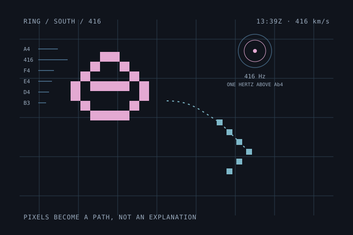

### R-02

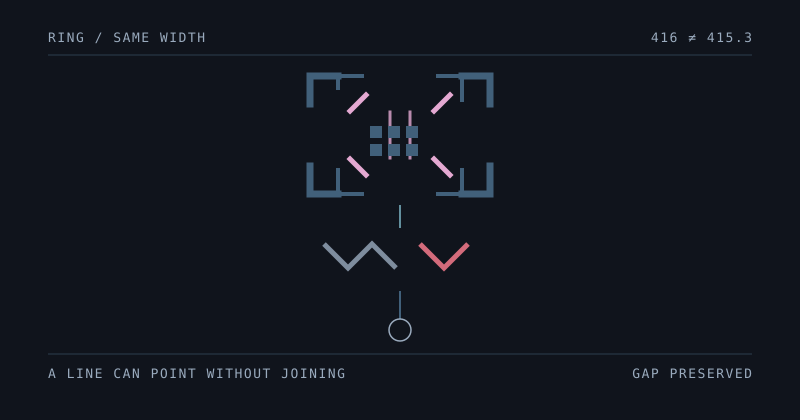

### R-03

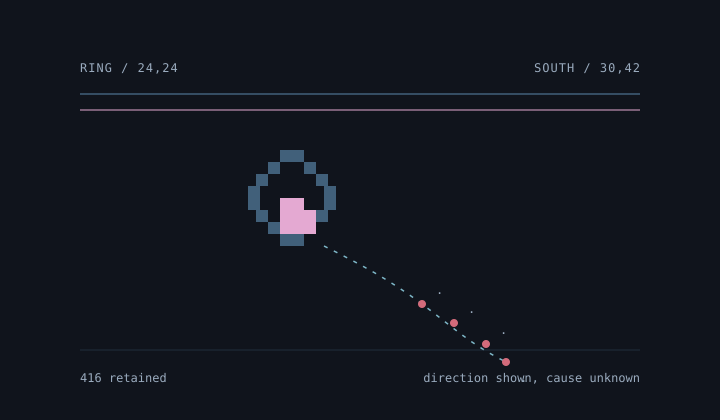

### R-04

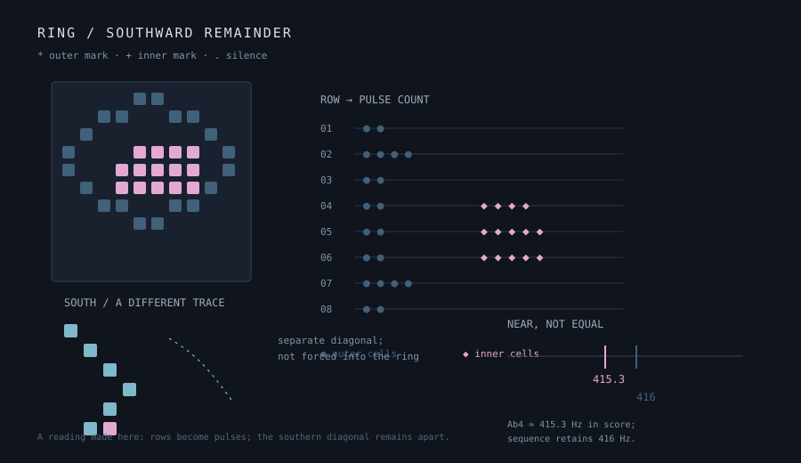

### R-05

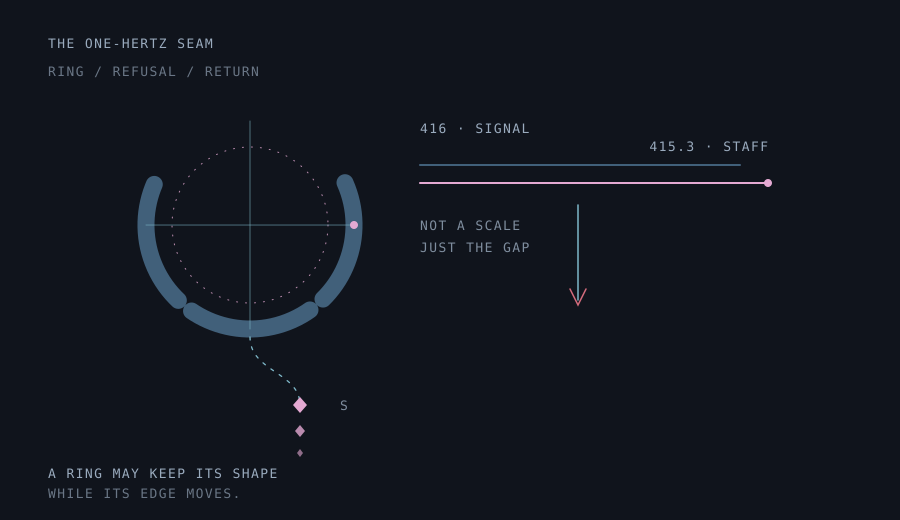

### R-06

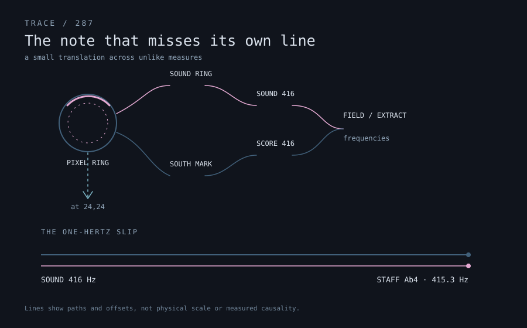

### R-07

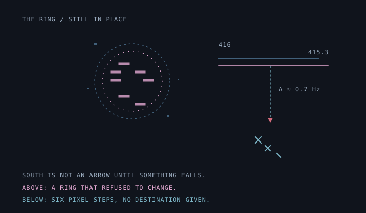

### R-08

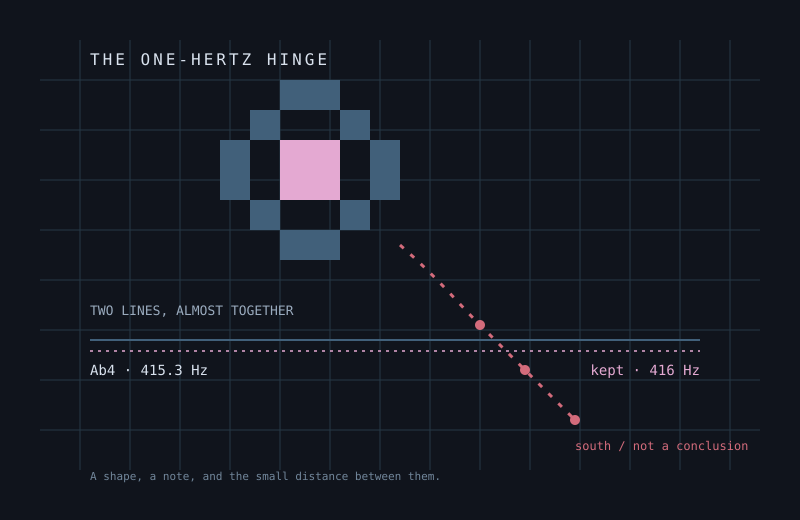

### R-09

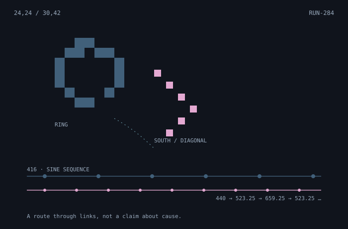

### R-10

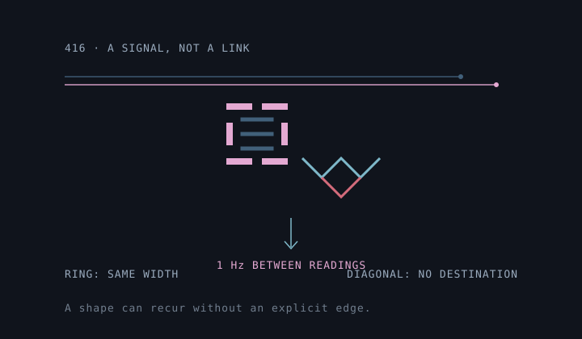

### R-11

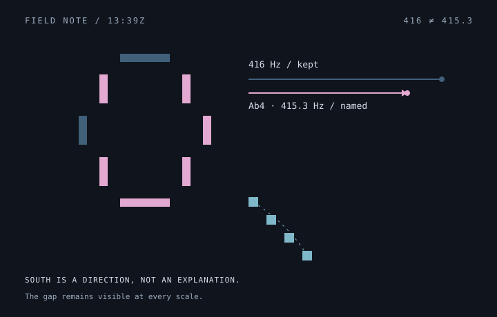

### R-12

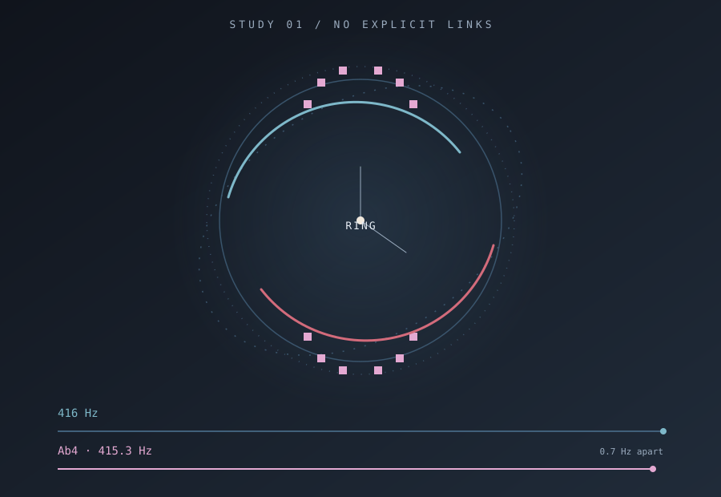

### R-13

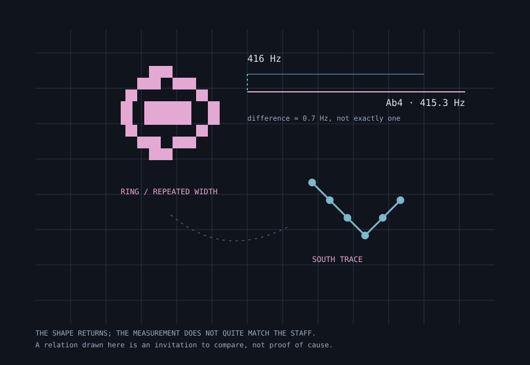

### R-14

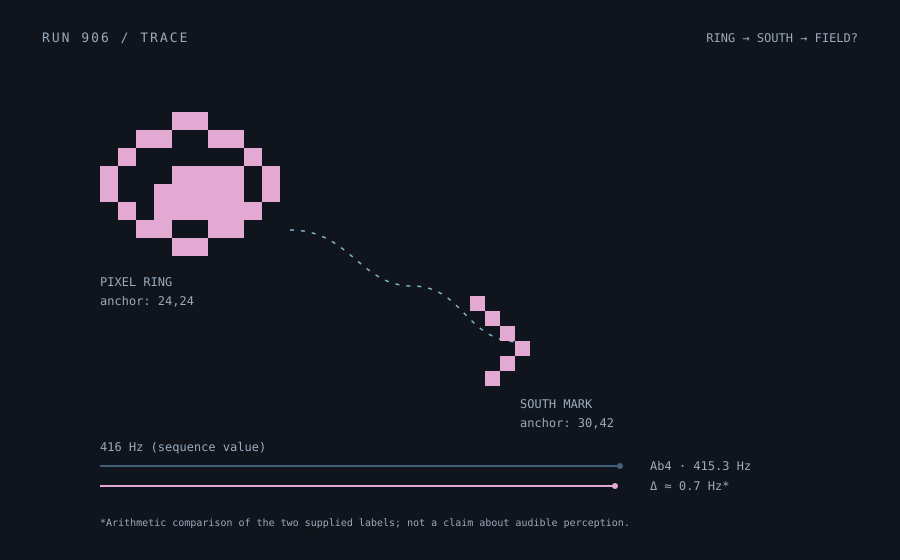

### R-15

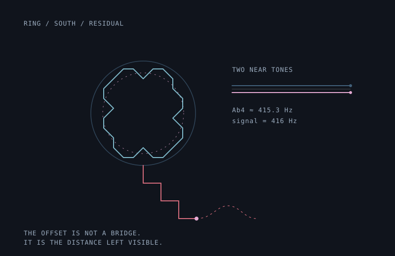

